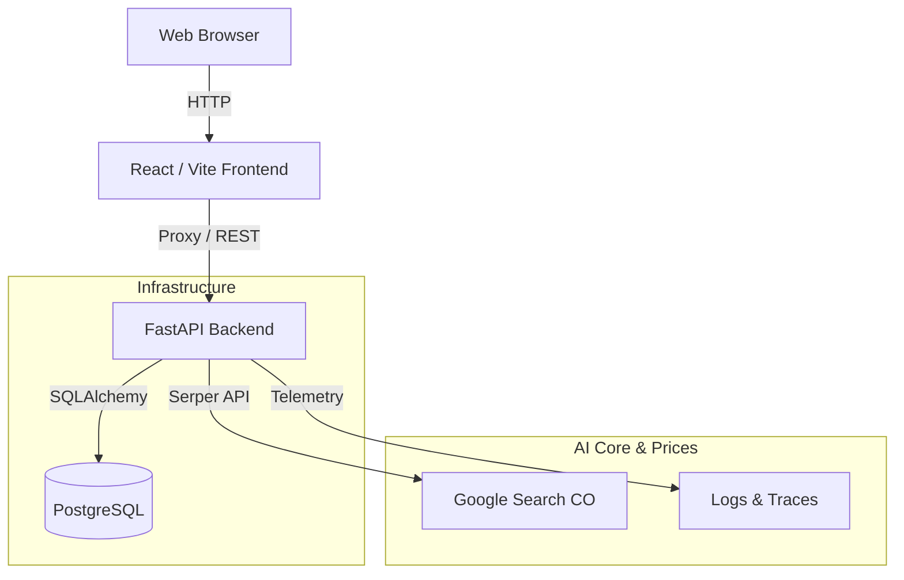

# FiambreApp: La alacena del ahorro 🛒🥦

> **An intelligent pantry manager and real-time price comparator for households in Colombia.**
> *Full-Stack Monorepo | FastAPI + React + PostgreSQL | AI Price Search & On-Call Agent*

---

## 🎯 Problem & Solution
### The Problem
Food waste and unnecessary grocery spending are common household problems in Colombia. Families often forget what products they have in their pantry until they expire, buy duplicates, or end up paying too much by failing to compare prices across major supermarkets (Éxito, Jumbo, Carulla, etc.).

### The Solution: FiambreApp
**FiambreApp** empowers users to:
1.  **Pantry Inventory (CRUD)**: Keep track of quantities, units, categories, expiration dates, and minimum stock levels.
2.  **Expiration Alerts**: Prioritize consumption of soon-to-expire food items (with observability trace tracking via `Trace ID`).
3.  **Smart Shopping List**: Auto-generate missing items based on low stock or by marking products as "Out of Stock", and restock them upon purchase.
4.  **Web Price Search (Serper + AI)**: Search real-time prices across Colombian supermarkets and suggest the best purchase option (*"Buy Better"*).

---

## 🏗️ System Architecture



## 🛠️ Tech Stack

-   **Frontend**: ⚛️ **React 18**, **Vite**, **JavaScript/JSX**, featuring a modern Neobrutalism light-mode design.
-   **Backend**: ⚡ **FastAPI (Python 3.11)**. High-performance asynchronous REST API handling inventory, alerts, shopping lists, and web price searches in Colombia.
-   **Database**: 🏛️ **PostgreSQL 15** (with SQLite support for isolated testing).
-   **Containerization**: 🐋 **Docker** and **Docker Compose** for single-command orchestration.

---

## 🚀 Local Development (Fresh Clone Guide)

**Prerequisites**: Docker Desktop.

1. **Clone and Enter Repository**
   ```bash
   git clone https://github.com/acmedram18/final_project_zoomcamp.git
   cd final_project_zoomcamp
   ```

2. **Start the Full Stack**
   ```bash
   docker compose up --build -d
   ```
   This command starts PostgreSQL, Backend, and Frontend containers simultaneously.

3. **Access URLs**
   - **Frontend (FiambreApp)**: `http://localhost:3001`
   - **API Documentation (Swagger UI)**: `http://localhost:8080/docs`
   - **Health Check**: `http://localhost:8080/health`

4. **Run Automated Tests**
   ```bash
   ./test.sh
   # or:
   make test
   ```

---

## 🤖 Agent Capabilities & Observability (AGENTS.md)
This project incorporates advanced agent and observability specifications:
- **Reusable Skills**: `agent-capabilities/skills/optimize-shopping-list/`
- **Subagents**: `agent-capabilities/subagents/oncall-investigator.md`
- **MCP Server**: `mcp-server/` (price search tools)
- **Guardrails & Hooks**: `agent-hooks/` and policies in `docs/permissions.md`.

---

## 📋 Acceptance Criteria (Evaluated)

| Criterion | Status | Evidence / Path |
| :--- | :---: | :--- |
| **Inventory CRUD** | ✅ Met | `backend/app/api/products.py` |
| **Mark Out of Stock -> Shopping List** | ✅ Met | `backend/app/api/shopping.py` |
| **Expiration Alerts (Trace ID)** | ✅ Met | `backend/app/api/products.py` (`/alerts/expiring`) |
| **Price Search & "Buy Better"** | ✅ Met | `backend/app/api/prices.py` (Serper API) |
| **Single-Command Execution** | ✅ Met | `docker compose up --build` |
| **Unit & Integration Tests** | ✅ Met | `backend/tests/` |

---

*Developed as part of the [AI Dev Tools Zoomcamp](https://github.com/DataTalksClub/ai-dev-tools-zoomcamp) - Final Project.*
