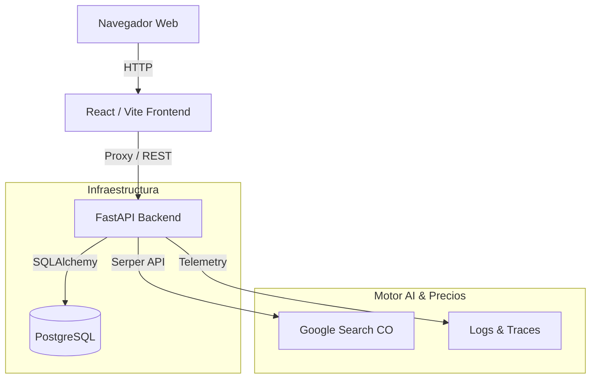

# FiambreApp: La alacena del ahorro 🛒🥦

> **Un gestor de despensa inteligente y comparador de precios en tiempo real para hogares en Colombia.**
> *Full-Stack Monorepo | FastAPI + React + PostgreSQL | AI Price Search & On-Call Agent*

---

## 🎯 Problema y Solución
### El Problema
El desperdicio de comida y los gastos innecesarios de mercado son problemas cotidianos en los hogares colombianos. Las familias suelen olvidar qué productos tienen en la alacena hasta que vencen, compran duplicados o terminan pagando de más por no comparar precios entre los principales supermercados (Éxito, Jumbo, Carulla, etc.).

### La Solución: FiambreApp
**FiambreApp** ayuda a los usuarios a:
1.  **Inventario de Alacena (CRUD)**: Mantener el control de cantidades, unidades, categorías, fechas de caducidad y stock mínimo.
2.  **Alertas de Expiración**: Priorizar el consumo de alimentos próximos a vencer (con trazabilidad mediante `Trace ID`).
3.  **Lista de Compras Inteligente**: Auto-generar artículos faltantes por stock bajo o al marcar productos como "Agotados", y reabastecer al comprarlos.
4.  **Comparador de Precios Web (Serper + IA)**: Buscar precios reales en supermercados colombianos y sugerir la mejor opción de compra (*"Comprar Mejor"*).

---

## 🏗️ Arquitectura del Sistema



## 🛠️ Stack Tecnológico

-   **Frontend**: ⚛️ **React 18**, **Vite**, **JavaScript/JSX**, con un diseño moderno estilo Neobrutalism en Modo Light.
-   **Backend**: ⚡ **FastAPI (Python 3.11)**. API REST asíncrona que gestiona inventarios, alertas, lista de compras y búsqueda web de precios en Colombia.
-   **Base de Datos**: 🏛️ **PostgreSQL 15** (con soporte para SQLite en testing).
-   **Containerización**: 🐋 **Docker** y **Docker Compose** para ejecución con un solo comando.

---

## 🚀 Ejecución Local (Guía Rápida con Docker)

**Prerrequisitos**: Docker Desktop.

1. **Clonar y Entrar al Repositorio**
   ```bash
   git clone https://github.com/acmedram18/final_project_zoomcamp.git
   cd final_project_zoomcamp
   ```

2. **Levantar el Sistema Completo**
   ```bash
   docker compose up --build -d
   ```
   Esta orden levantará PostgreSQL, el Backend y el Frontend simultáneamente.

3. **URLs de Acceso**
   - **Frontend (FiambreApp)**: `http://localhost:3001`
   - **Documentación de la API (Swagger UI)**: `http://localhost:8080/docs`
   - **Health Check**: `http://localhost:8080/health`

4. **Ejecutar Pruebas Automatizadas**
   ```bash
   ./test.sh
   # o bien:
   make test
   ```

---

## 🤖 Capacidades de Agentes y Observabilidad (AGENTS.md)
Este proyecto integra especificaciones avanzadas de agentes y observabilidad:
- **Habilidades Reutilizables**: `agent-capabilities/skills/optimize-shopping-list/`
- **Subagentes**: `agent-capabilities/subagents/oncall-investigator.md`
- **Servidor MCP**: `mcp-server/` (herramientas de búsqueda de precios)
- **Guardrails y Hooks**: `agent-hooks/` y políticas en `docs/permissions.md`.

---

## 📋 Criterios de Aceptación (Evaluados)

| Criterio | Estado | Evidencia / Ruta |
| :--- | :---: | :--- |
| **CRUD de Inventario** | ✅ Cumplido | `backend/app/api/products.py` |
| **Marcar Agotado -> Lista de Compras** | ✅ Cumplido | `backend/app/api/shopping.py` |
| **Alertas de Expiración (Trace ID)** | ✅ Cumplido | `backend/app/api/products.py` (`/alerts/expiring`) |
| **Búsqueda de Precios y "Comprar Mejor"** | ✅ Cumplido | `backend/app/api/prices.py` (Serper API) |
| **Ejecución con un Solo Comando** | ✅ Cumplido | `docker compose up --build` |
| **Tests Unitarios e Integración** | ✅ Cumplido | `backend/tests/` |

---

*Desarrollado como parte del [AI Dev Tools Zoomcamp](https://github.com/DataTalksClub/ai-dev-tools-zoomcamp) - Proyecto Final.*
